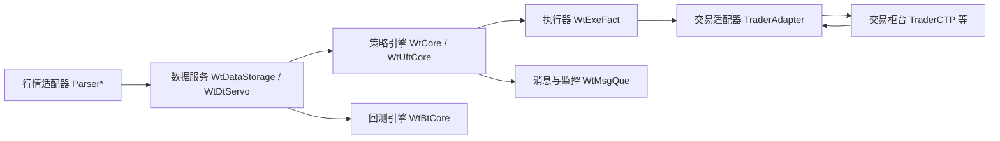
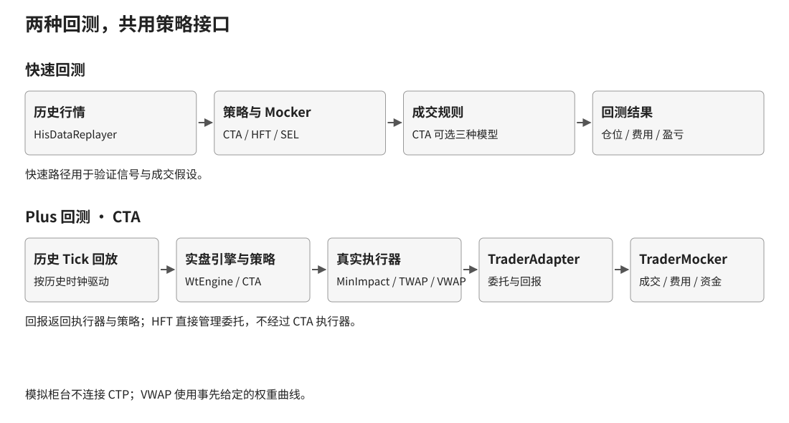

# WonderTrader-plus

基于 [WonderTrader](https://github.com/wondertrader/wondertrader) 二次开发的 C++ 量化交易系统，
保留上游来源与 MIT 许可，不是 WonderTrader 官方发行版。

原版 WonderTrader（WT）是以 C++ 为核心的量化研发与交易框架：行情接入、策略引擎（CTA/HFT/UFT/SEL）、
统一回测、执行器与交易通道、数据存储和运行监控，并通过 [wtpy](https://github.com/wondertrader/wtpy) 提供 Python 接口。
本仓库在保留原版架构的前提下，补充实盘引擎回放时钟（Plus 回测）、模拟柜台费用与保证金记账、
账户与持仓快照接口、策略重置/对账/启动保护，
并与 [wtpy-plus](https://github.com/newbigdeng/wtpy-plus) 配套组成完整工作台：
C++ 负责引擎、执行、模拟柜台与账户账簿，Python 负责任务编排、策略接口与网页服务。


## 架构介绍

系统按「行情接入 → 策略引擎 → 执行器 → 交易适配器 → 柜台与账户」分层。
实盘与 Plus 回测共用同一条执行链，快速回测走 `WtBtCore` 的内置撮合。



| 层 | 模块 | 职责 |
| --- | --- | --- |
| 接口 | `Includes` | 行情、交易、策略、执行、数据的对外接口与结构 |
| 引擎 | `WtCore`、`WtUftCore` | CTA/HFT/SEL 引擎、策略上下文、执行管理、适配器与风控接入；UFT 独立运行 |
| 回测 | `WtBtCore` | 历史回放、CTA/HFT/SEL/UFT Mocker、成交模型、执行单元回测 |
| 执行 | `WtExeFact`、`WtExecMon` | MinImpact、TWAP、VWAP 等执行单元；独立算法执行入口 |
| 接入 | `Parser*`、`Trader*` | 行情与交易插件，按 `IParserApi` / `ITraderApi` 接口加载 |
| 数据 | `WtDataStorage`、`WtDataStorageAD`、`WtDtCore`、`WtDtServo` | 实时 DMB 与历史 DSB 存储、LMDB 扩展、数据广播与伺服 |
| 消息 | `WtMsgQue` | 基于 NNG 的消息通道，向监控与外部服务推送事件 |
| 桥接 | `WtPorter`、`WtBtPorter`、`WtDtPorter` | 导出 C 接口供 Python 调用 |
| 运行 | `WtRunner`、`WtBtRunner`、`WtUftRunner`、`LoaderRunner` | 实盘、回测、UFT 与合约加载进程入口 |

**插件化接入。** 行情适配器实现 `IParserApi`，交易适配器实现 `ITraderApi`，执行单元实现 `IExecCommand`，
三者由 CMake 单独编译成动态库并按配置加载。新增柜台只需实现对应接口，不修改引擎。

**目标仓位到委托。** 策略只设置目标仓位，CTA 引擎汇总后交给执行管理器；
本地执行器比较目标、通道持仓与在途委托，调用 `TraderAdapter` 下单；
`TraderAdapter` 维护通道委托、成交、持仓与资金，柜台回报再逐层回传。
HFT 策略直接通过交易通道报单与撤单，不经 CTA 执行器。

**两套回测。** 快速回测走 `WtBtCore`：`HisDataReplayer` 回放历史行情，`CtaMocker`/`HftMocker`/
`SelMocker`/`UftMocker` 直接撮合，用于验证信号与参数。Plus 回测走实盘引擎：`WtRtRunner`
读取 `env.replay` 进入回放模式，由 `plus_replay_flush` 推进时间，交易侧接入独立进程的
`TraderMocker` 模拟柜台，委托、成交、费用和资金都走原生账簿，成交由历史盘口驱动。



快速回测的 CTA 成交判断抽取为可插拔成交模型：
`legacy_cta` 保持原版撮合，`causal_touch` 按事件顺序取对手价，`volume_limited` 按参与量限制并允许部分成交。
K 线回放配置 `close_only` 时每根闭合 K 线只产生一个收盘事件，其他配置走旧的四价路径。

## 功能介绍

**行情与数据**
- 行情与交易适配器覆盖期货（CTP、CTPMini、Femas、易达）、期权（CTPOpt）、
  股票（XTP、XTPXAlgo、华鑫奇点、华锐 ATP、宽睿 OES）等柜台；`ParserUDP` 与 `ParserShm`
  负责进程间行情分发。
- 实时行情写入 DMB 文件，历史数据压缩为 DSB；`WtDtServo` 向多个策略进程分发同一份行情，
  形成一份数据服务多个策略的 1+N 结构。
- 行情采集由独立进程 `QuoteFactory` 完成，`LoaderRunner` 与 `CTPLoader` 负责合约信息加载；
  这些进程可以脱离策略单独运行。
- `WtDtHelper`、`WTSTools` 提供数据读取、检查、格式转换和合约工具。

**策略引擎**
- CTA 引擎：事件与时间驱动，适合单标的择时、中低频套利。
- HFT 引擎：事件驱动，策略直接报单与撤单。
- UFT 引擎：独立于 `WtCore` 的极速引擎，面向超低延迟场景。
- SEL 引擎：时间驱动、异步计算，面向多标的选股与多因子组合。
- 提供四类 C++ 策略工厂；Python 接口导出 CTA、HFT、SEL 回调，UFT 仅在 C++ 侧使用。

**回测**
- 快速回测支持 CTA、HFT、UFT、SEL 策略和执行单元，C++ 与 Python 策略共用同一回测引擎。
- Plus 回测复用实盘引擎与执行器，支持 MinImpact、TWAP、VWAP 等拆单方式，
  输出原生委托、成交和资金流水，用于检查执行链路与资金链路。
- Python 侧只读取 C++ 回测输出，不另算一份成交；快速回测仍由 `WtBtCore` 内部统计资金与费用。

**交易与账簿**
- `TraderAdapter` 统一维护通道委托、成交、持仓和资金，支持今仓与昨仓分别记账、
  期权行权冻结、套保与投机持仓分行处理。
- 提供账户查询、组合快照、连接状态和拒单事件输出，供监控、风控和工作台读取。
- `TraderMocker` 作为模拟柜台复用 WT 的 `calcFee`，处理合约优先的手续费匹配、最低手续费、
  开平与平今费率、保证金冻结与释放、滑点、部分成交和撤单后的资金恢复；资金不足时拒绝开仓并记录原因。

**风控与运行监控**
- 沿用原版风控：组合资金风控、通道流量风控、账户回撤风控、离合器与人工紧急介入。
- `WtRiskMonFact` 提供基于引擎资金信息的日内与多日回撤风控。
- 引擎原生过滤由 `WtFilterMgr` 按配置调整目标仓位；工作台侧的暂停决策控制见 wtpy-plus README。
- 提供策略重置、对账与启动保护接口，可在不撤单、不重置账簿的前提下核对持仓与委托。
- `WtMsgQue` 推送运行事件，配套工作台见 [wtpy-plus](https://github.com/newbigdeng/wtpy-plus)。

## 技术介绍

**语言与构建**

- C++17，CMake 按模块组织（`src/CMakeLists.txt`，最低 3.10），Ninja 构建，当前构建与测试平台为 Linux x86_64。
- 根 `Dockerfile` 三阶段构建：`ubuntu:26.04` 工具链 → 编译 → 保留运行所需动态库、头文件与源码测试；
  `docker/stage_native.py` 收集运行目标、复制 CTP 厂商库并用 `ldd` 校验依赖。
- `WT_PLUS_RUNTIME_ONLY=ON`（默认）只构建运行所需模块：核心引擎、回测、数据、桥接、
  CTP/UDP/Shm 行情、CTP 交易、模拟柜台、执行器与 UFT 运行器；关闭该选项会额外构建
  `QuoteFactory`、`CTPOptLoader`、`WtExecMon`、`WtRunner`、更多上游适配器与 `Test*` 工程。
- 部分上游适配器（华鑫奇点、宽睿 OES、华锐 ATP 等）仅保留 MSVC 工程，不在 CMake 构建内。
- 保留 MSVC 工程文件与 `dist/` 预编译 Windows 发布目录，兼容原版 Windows 使用方式。

**依赖与兼容**

| 依赖 | 说明 |
| --- | --- |
| GCC、Boost、Boost.Asio、NNG | Ubuntu 26.04 系统包，构建时未固定版本 |
| CTP SDK 6.7.13 | `src/API/CTP6.7.13-*`，厂商库保留原有条款 |
| spdlog 1.3.1、RapidJSON 1.0.2 | `third_party/compat` 保留原始头文件，兼容旧日志与 JSON 接口 |
| OpenSSL、zlib、curl | 加密、压缩与网络请求 |

**工程改造**
- 消息通道由 nanomsg 迁移到 NNG，保留 pub/sub 消息接口，构建产物不再依赖 `libnanomsg`。
- UDP 与共享内存行情适配器改用 Boost.Asio `io_context`；XTP、XeleSkt 等仍基于 Boost.Asio 的适配器继续使用 `io_service`，CTP 系列适配器不依赖 Boost.Asio。
- 日志和 JSON 接口保留上游兼容头文件，Boost/Asio/NNG 则链接系统库，避免一次性替换所有依赖。

**测试**

```bash
# 只构建运行所需模块
cmake -S src -B build -G Ninja -DCMAKE_BUILD_TYPE=Release -DWT_PLUS_RUNTIME_ONLY=ON
cmake --build build --parallel

# 编译并运行原生定点测试
cmake -S src -B build-tests -G Ninja -DCMAKE_BUILD_TYPE=Release -DWT_PLUS_BUILD_TESTS=ON
cmake --build build-tests --parallel
ctest --test-dir build-tests --output-on-failure
```

`tests/native` 有 10 个测试源码，`ctest` 目前注册其中 8 个，覆盖行情可见性、通道持仓、
柜台查询结果、组合状态、策略核对、策略重置、模拟柜台资金等；`execution_quality` 只编译未注册，
消息通道探针需加 `WT_PLUS_BUILD_PROBES=ON` 单独编译。测试使用本地假柜台与合成数据，不连接真实柜台。

**配套技术栈**

Python 工作台 [wtpy-plus](https://github.com/newbigdeng/wtpy-plus) 使用 Python + FastAPI + SQLite，
前端为 Vue 3 + Vite，通过 `WtPorter` / `WtBtPorter` / `WtDtPorter` 调用本仓库构建的动态库。
两个仓库分别以 `wt-plus` 与 `py-plus` 分支配套发布。

## 相关仓库与许可

- 上游项目：[WonderTrader](https://github.com/wondertrader/wondertrader)、[wtpy](https://github.com/wondertrader/wtpy)
- 配套工作台：[wtpy-plus](https://github.com/newbigdeng/wtpy-plus)
- 许可：[MIT](LICENSE)；CTP 等厂商 SDK 保留其原有条款。
