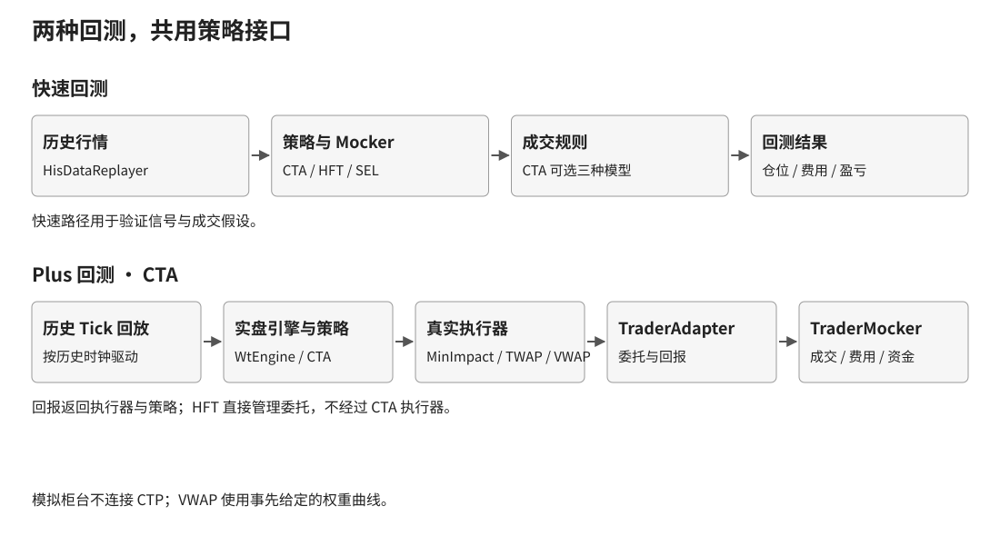

# WonderTrader-plus

基于 [WonderTrader](https://github.com/wondertrader/wondertrader) 的二次开发。
保留上游来源、MIT 许可和 Git 历史。
本仓库不是 WT 官方发行版。

WonderTrader（WT）是 C++ 量化交易框架。
它提供行情接入、策略引擎、回测和交易执行。
[wtpy-plus](https://github.com/newbigdeng/wtpy-plus) 提供 Python 策略和网页工作台。

## 怎么读这个仓库？

先看两条回测链，再按 Docker 步骤启动。
写策略和使用监控，请看配套 wtpy-plus。
旧的开发记录留在历史分支。

## 原版 WT 怎样连接行情、策略和交易？

行情驱动策略，执行器把目标仓位变成委托。

CTA 策略先决定想持有多少仓位。
执行器再决定何时、按什么价格报单。
交易适配器维护委托、成交、持仓和资金。


- `ParserAdapter`：统一行情接入。
- CTA 引擎：运行策略并汇总目标仓位。
- 执行器：拆单、定价和撤单重报。
- `TraderAdapter`：连接柜台并处理回报。
- 数据组件：存储行情，并提供历史读取。

HFT 策略直接管理委托，调用链与 CTA 有区别。
上游原始架构图也继续保留：


## 为什么保留两套回测？

快速回测验证想法，Plus 回测检查执行路径。

一个目标仓位，在回测里可能立即完成。
在实盘里，它需要经过拆单和交易回报。
两种路径回答的问题不同，所以都保留。



| 选择 | 运行路径 | 适合检查什么 |
| --- | --- | --- |
| 原版快速回测 | 历史回放 → Mocker | 信号、参数和成交假设 |
| Plus 回测 | 历史回放 → 实盘引擎 → 模拟柜台 | 执行、资金和回报处理 |

快速 CTA 回测保留三种成交模型：

- `legacy_cta`：保持原版成交规则。
- `causal_touch`：按事件顺序和有效报价成交。
- `volume_limited`：限制参与量，允许部分成交。

Plus CTA 使用真实执行器和 `TraderAdapter`。
可选择 MinImpact、TWAP 或 VWAP。
TWAP（按时间拆单）分时执行目标量。
VWAP（按量分配）使用预先提供的权重曲线。
回放不会用未来 Tick 计算这条曲线。

Plus HFT 保留直接委托路径。
它不套用 CTA 执行器。
运行入口见配套 Python 仓库的 `PlusReplayRunner`。

## 手续费、滑点和保证金怎样处理？

成交和资金计算共用模拟柜台的账户账簿。

拆单只成交一部分时，也只能扣这部分费用。
委托撤销后，占用的资金必须释放。
否则可能算错可用资金，并错误拒单。

| 项目 | 处理方式 |
| --- | --- |
| 手续费 | 复用 WT `calcFee`，支持按手或金额计费 |
| 最低手续费 | 按每次成交收取，区分开、平、平今 |
| 配置匹配 | 合约优先，其次品种；缺费率直接提示 |
| 保证金 | 显式覆盖优先，其次品种、合约方向费率 |
| 开仓委托 | 冻结保证金和预计费用 |
| 部分成交、撤单 | 更新或释放冻结金额 |
| 资金不足 | 拒绝开仓，并记录原因 |
| 滑点 | 按不利方向增加指定跳数 |
| 限价和涨跌停 | 成交价不突破委托和价格限制 |

每次任务固定策略源码、费用和执行参数。
同时记录数据集编号和回放范围。
运行记录包含原生委托、成交和资金输出。
Python 展示这些结果，不另算一套成交账簿。
品种的非零 `marginrate` 沿用 WT 覆盖规则。
没有品种覆盖时，使用合约的多空费率。

## 引擎和通信改了哪些地方？

重点修复回报、撮合和退出时的状态一致性。

- nanomsg 替换为 NNG，保留消息接口和帧格式。
- Boost.Asio 改用 `io_context` 等现行接口。
- 修复异步通知工作对象和关闭顺序。
- 修复 HFT/UFT 剩余量、部分成交及方向处理。
- 修复行情对象释放和撮合回调插入问题。
- 未订阅的 Bar 不再插入无用订阅键。
- 修复合约保证金率被静态局部值串用的问题。
- 增加账户查询入口、连接状态及拒单事件输出。

暂停和过滤保持不同含义。
暂停决策回调保留已有持仓。
过滤沿用 WT 的目标调整流程。
是否归零取决于过滤配置及后续执行成交。

主要源码入口：

| 内容 | 文件 |
| --- | --- |
| 快速 CTA 成交模型 | [CtaFillModel.h](src/WtBtCore/CtaFillModel.h) |
| 快速回测记账 | [CtaMocker.cpp](src/WtBtCore/CtaMocker.cpp) |
| Plus 模拟委托 | [TraderMocker.cpp](src/TraderMocker/TraderMocker.cpp) |
| Plus 费用与资金 | [TraderMockerFinance.cpp](src/TraderMocker/TraderMockerFinance.cpp) |
| TWAP / VWAP | [WtExeFact](src/WtExeFact) |
| 柜台状态与资金输出 | [TraderAdapter.cpp](src/WtCore/TraderAdapter.cpp) |
| Python 原生桥 | [WtPorter](src/WtPorter) |
| 消息通信 | [WtMsgQue](src/WtMsgQue) |

## 新环境使用哪些技术？

Linux 镜像从源码构建选定的运行组件。
当前构建和测试平台为 Linux x86_64。

| 层 | 已使用的版本 |
| --- | --- |
| 系统 | Ubuntu 26.04 |
| C++ | GCC 15.2，C++17 |
| 构建 | CMake 4.2.3，Ninja |
| 网络与异步 | Boost 1.90 / Boost.Asio 1.38 |
| 消息通信 | NNG 1.11 |
| CTP | 6.7.13，头文件与厂商库配套 |
| Python 工作台 | Python 3.14，FastAPI，SQLite |
| 网页工作台 | Vue 3，Pinia，Element Plus，Vite |

选定的日志和 JSON 头文件仍保留兼容版本。
详情见 [third_party/compat](third_party/compat/README.md)。
这不是全部第三方库都升级到最新版的声明。

## 怎样用 Docker 从零构建？

先构建原生镜像，再构建配套工作台。

```bash
git clone -b wt-plus https://github.com/newbigdeng/WonderTrader-plus.git
git clone -b py-plus https://github.com/newbigdeng/wtpy-plus.git
docker build --build-arg BUILD_JOBS=2 \
  -t wondertrader-plus:native ./WonderTrader-plus
cd wtpy-plus
docker compose up -d --build
```

打开 `http://127.0.0.1:8100/console/`。
首次启动会创建独立管理员。
读取初始密码的方法见配套仓库 README。
数据放在 Docker 数据卷，不写进镜像。

在虚拟机运行时，用 SSH 转发到 Windows：

```bash
ssh -N -L 127.0.0.1:8100:127.0.0.1:8100 用户名@虚拟机地址
```

Docker 默认仅发布本机端口。
启动工作台不会自动连接柜台或下单。

## 性能变化测了多少？

已测消息通信和指定的撮合热点。

同一共享虚拟机的本地 IPC 对照：
每种报文各跑 5 轮，每轮 1000 条。
每次仅一条消息在途，统计每轮分位数的中位数。
在同一新容器内加载旧库和新库。
旧库使用 GCC 8.4，新库使用 GCC 15.2。

| 报文 | 旧通道 P50 | 新通道 P50 | 延迟下降 |
| --- | ---: | ---: | ---: |
| 256 字节 | 1.257 ms | 1.055 ms | 16.0% |
| 4096 字节 | 1.291 ms | 0.972 ms | 24.7% |

同一组 4096 字节测量中：
P99 从 4.579 ms 降为 3.167 ms，下降 30.8%。
该测量包含 Python 回调和虚拟机调度。
传输实现及工具链同时改变，不能单独归因。

HFT 撮合热点在同一新工具链下对比源码。
1000 笔不成交挂单，交替运行 7 轮。
每轮回放 10000 Tick，计算每 Tick 平均耗时。
七轮均值的中位数从 65.25 μs 降为 61.33 μs。
动态分配从每 Tick 11 次降为 1 次。
轮间耗时存在重叠，不代表整机提升约 6%。

## 边界与不能说的结论

Plus 当前支持 CTA 和 HFT Python 策略。
UFT 不会被悄悄替换成 HFT。
模拟成交不包含真实排队、冲击和网络延迟。
保证金没有模拟组合优惠、强平和每日结算重置。
结束时保留持仓，不凭空生成平仓行情。
柜台已收费用以账户回报为准。
现有测试不能证明策略盈利或实盘成交质量。
没有单独测出 Ubuntu、GCC 或 Asio 的收益。

原版项目：[WonderTrader](https://github.com/wondertrader/wondertrader)。
配套项目：[wtpy-plus](https://github.com/newbigdeng/wtpy-plus)。
许可：[MIT](LICENSE)。厂商 SDK 保留其原有条款。
