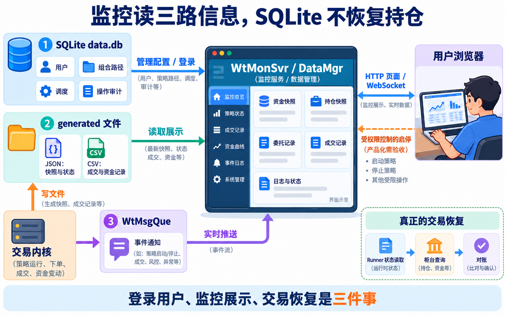

# 保证金、风控与因子数据库

核对日期：2026-10-13。以 VM 当前运行源码及配套 wtpy 为依据；代码是关键摘录，省略部分以文字说明。模拟盘真实验收与架构解释分别表述。

<!-- WT-ILLUSTRATION:04_monitor_relations:START -->
<figure class="wt-illustration">
<a class="wt-image-link" href="../images/04_monitor_relations.png" title="点击打开原图"></a>
<figcaption><strong>监控三种数据源</strong>。监控关系概念图；监控 data.db 与本篇建议的独立因子库职责不同，图中关系不表示数据库或服务已经完成产品化。</figcaption>
<p class="wt-original"><a href="../images/04_monitor_relations.png">打开原图，放大阅读</a></p>
</figure>
<!-- WT-ILLUSTRATION:04_monitor_relations:END -->

## 1．保证金、资金约束和因子数据库

### 5.1 WT 有保证金字段，但三个运行环境的约束不同

| 环境 | 保证金与可用资金从哪里来 | 责任边界 |
| --- | --- | --- |
| TraderCTP 接柜台 | 柜台账户、持仓回报有 margin、available、冻结资金等；柜台最终执行可开仓检查 | 策略/组合要在提交前做预算，不应等柜台拒单才处理风险 |
| 本地 TraderMocker | 当前 `queryAccount` 返回 CNY 账户各资金项全0，包括 margin、available、frozenMargin | 主要模拟委托/成交/持仓接口，没有完整资金账本与期货保证金冻结释放机制 |
| CTA 历史回测 | CtaMocker 统计已实现盈亏、浮盈、费用 | 成交模型与账本不因资金不足自动拒绝开仓；分析器初始本金只是统计分母 |

本机 `src/TraderMocker/TraderMocker.cpp:848` 的原始核心代码：

```cpp
accountInfo->setBalance(0);
accountInfo->setMargin(0);
accountInfo->setAvailable(0);
accountInfo->setFrozenMargin(0);
```

WT 品种/合约类已有保证金率字段，`WtEngine.cpp:884` 也可读取 `margin`；这证明它有基础信息承载能力，不能据此推断 CTA 回测已建立资金冻结、可开仓校验、日终盯市和强平机制。是否拒单要看具体入口有没有计算并使用这些字段。

策略可保守估算：`所需保证金 ≈ 手数 × 合约乘数 × 当前价格 × 估计保证金率`，再加手续费、滑点、波动与提高保证金的缓冲；限制单品种/总组合占用比例、最大手数、日亏损和撤单失败。估计保证金率必须来自实际账户/柜台或可靠配置，不能硬编码一个率就当作所有品种通用。实盘/CTP 模拟以柜台结果为准；本地模拟和回测若要严格资金验收，还需有独立且一致的资金风控计算，不能将收益曲线有本金等同于已做资金管理。

这段是代码能力解释，不是声称本次已实现保证金引擎或验证了柜台拒单。

### 5.2 WT 没有开箱即用的通用因子平台，扩展点可以接数据库

wtpy 有指标输出接口 `BaseIndexWriter.write_indicator(id, tag, time, data)`，`WtBtEngine.set_writer` 可注册实现；也有扩展行情加载器 `BaseExtDataLoader`、策略用户数据等。自带数据工具中存在股票**复权因子**导入导出与 MySQL 示例；复权因子是价格调整元数据，不是研究平台所说的 alpha 因子库。不能看到 `adj_factors` 就说框架已自带完整因子数据库。

SQLite 可以做小规模因子存储：例如独立 `factors.db` 中保存 `instrument、event_time、available_time、factor_name、version、value`，并给 `(instrument, event_time, factor_name, version)` 建唯一键。最关键是 `available_time`，回测查询必须满足 `available_time <= 当前回放时刻`，否则会把当时尚未公布的数据泄漏给策略。跨日修订数据还要保留版本或发布日期，保证历史可复现。

实现方式是在策略 init 加载所需窗口，或通过自定义指标 writer 批量写入；避免每条 Tick 同步插入磁盘。SQLite 的事务与索引适合单机、小团队研究；高频大量数据、多写入者、高并发查询则要根据实际负载选更适合的存储。这里没有随任务新建因子库，也没有把监控数据库混作因子库。

**监控 SQLite 存用户、权限、分组、任务等管理信息，不是策略仓位账本。** 用某用户登录监控，不会根据他的用户行自动恢复 C++ 持仓。持仓恢复由 Runner / 交易通道的 JSON 状态与柜台查询/对账决定；监控数据库和运行目录的数据应分别维护。

来源：本机 `wtpy/ExtToolDefs.py:14(BaseIndexWriter)`、`wtpy/WtBtEngine.py:83(set_writer)`、`wtpy/ExtModuleDefs.py:BaseExtDataLoader`、`wtpy/apps/datahelper/db/MysqlHelper.py:124(writeFactors)`；本机 `src/WtCore/TraderAdapter.cpp:366(输出margin)`，`src/Includes/WTSContractInfo.hpp:269、275(品种保证金率)`；监控细节由对应监控章节进一步说明。

## 2．SQLite 因子库怎样避免未来数据

因子表可独立放在 factor.db，保存 trade_date、code、factor、value、version，另有 available_at 表示当时何时可知；查询只取 available_at 不晚于策略决策时刻的数据。不要用监控 data.db 的 users 表存因子。

```sql
CREATE TABLE factors (
  trade_date INTEGER NOT NULL, code TEXT NOT NULL,
  factor TEXT NOT NULL, value REAL,
  available_at TEXT NOT NULL, version TEXT NOT NULL,
  PRIMARY KEY(trade_date, code, factor, version)
);
CREATE INDEX factor_visibility ON factors(code, factor, available_at);
```

时间统一用 UTC 的 ISO 格式，保留原始版本；预测标签与输入特征分开。SQLite 的 WAL 支持读写并发，但同一时刻仍只有一个写者，且 WAL 不适合跨机器共享网络文件。适合单机小规模因子研究，不能因此把它当作完整高频行情/多写者因子服务。[SQLite 官方 WAL 文档](https://www.sqlite.org/wal.html)

保证金比例、手续费与交易所规则会变化。本文策略的20%与每边2元仅是诊断假设，不是实际柜台费率。合约乘数和跳价请以基础资料与官方合约核对。[上期所螺纹钢业务细则](https://www.shfe.com.cn/regulation/exchangerules/productrules/202512/t20251231_829962.html)
