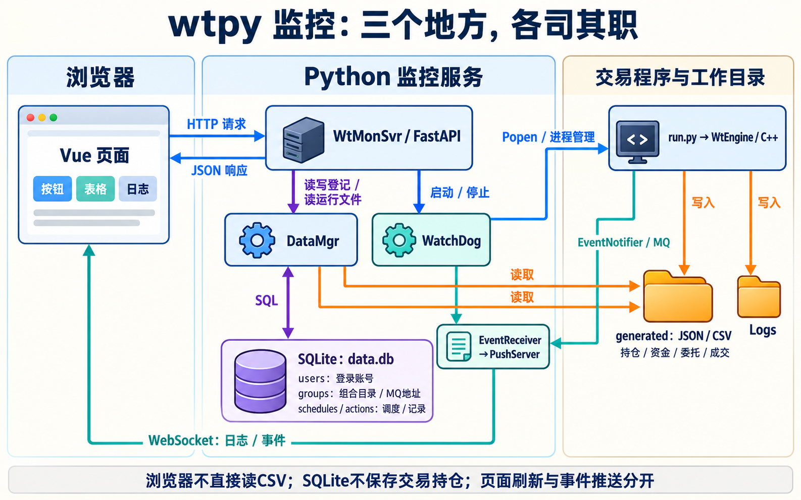
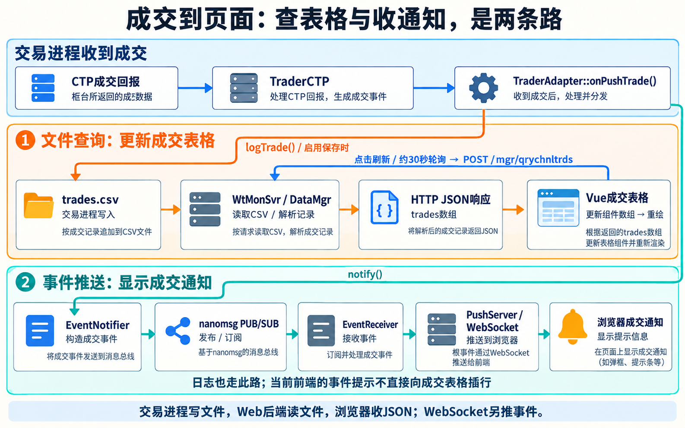
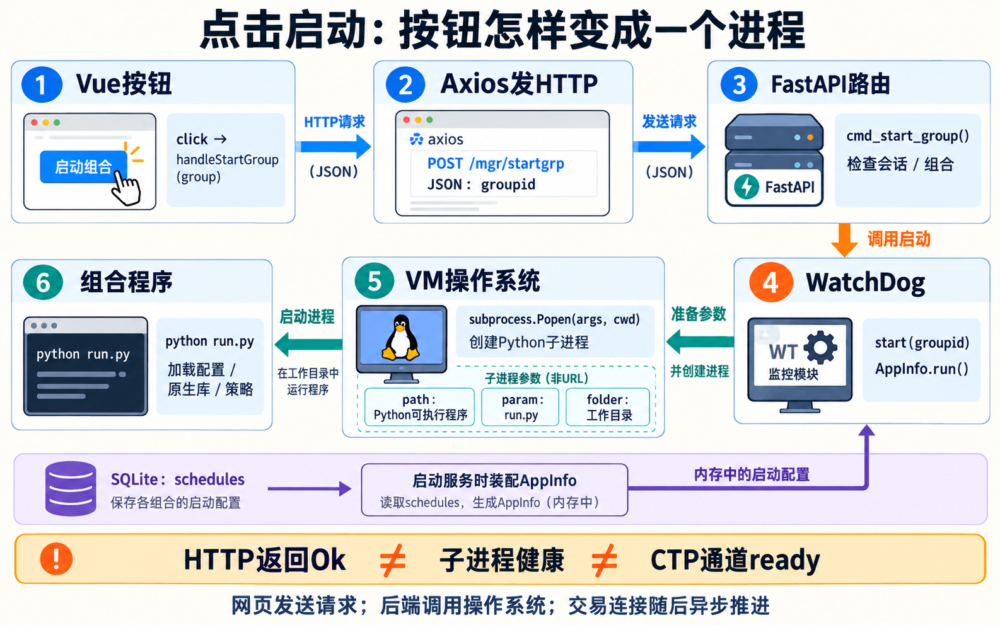
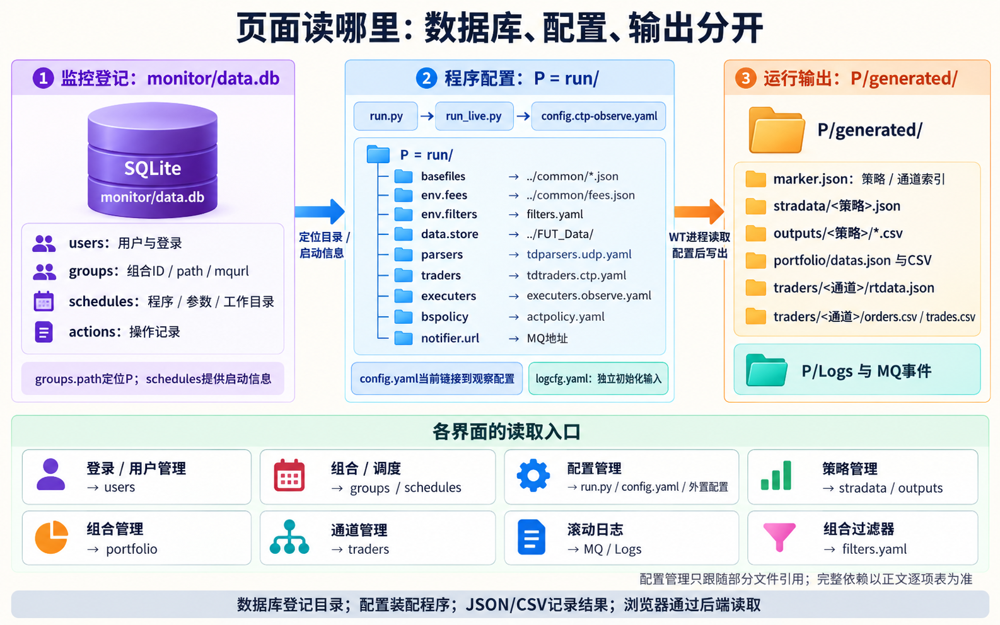
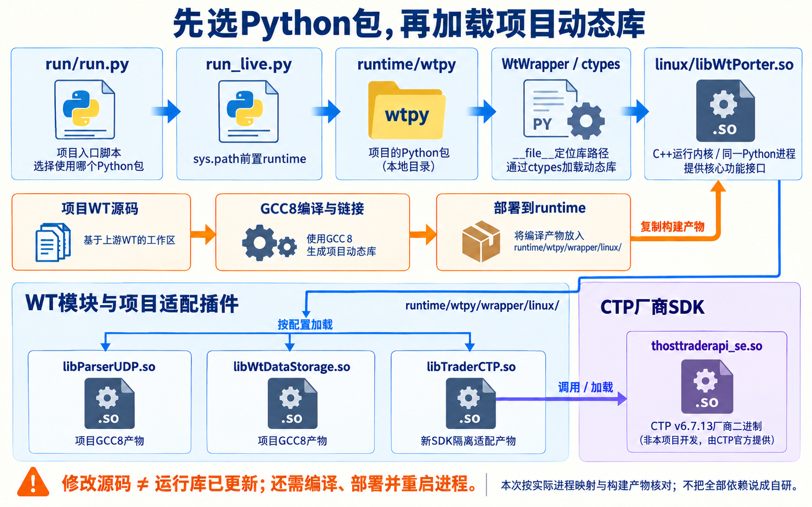
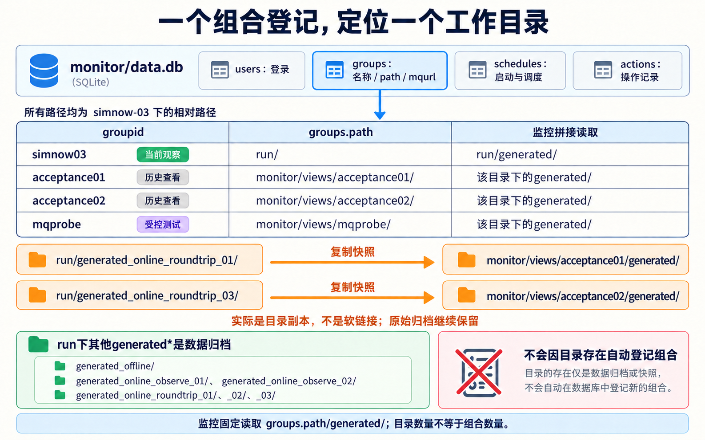

# wtpy 监控原理：账号、页面、运行数据与修改边界

更新：2026-10-15；本轮补充前后端联动源码讲解与三张概念图，没有新增运行测试。依据本仓库 WT 源码、配套 wtpy 主源码，以及 `simnow-03` 的实际监控部署与定向验证。

**核心结论：监控是 WT 运行目录上面的一层管理后台。它从 SQLite 找到“组合对应哪个目录、哪个程序、哪个 MQ 地址”，从 JSON、CSV 读取运行结果，通过 WatchDog 管理进程，再通过 MQ 和 WebSocket 推送日志与事件。SQLite 保存后台登记信息，交易账本主要保存在 `generated` 中。**

因此，“网页刷新了”“收到了成交通知”“刚向 CTP 查过资金”要分别理解。它们经过的链路不同，完成时间也可能不同。

<figure class="wt-illustration">
<a class="wt-image-link" href="../images/10_monitor_modules.png" target="_blank" rel="noopener"></a>
<figcaption>总览把页面控制、文件查询和事件推送分开。WatchDog还直接读写同一SQLite的调度表，后文的启动图单独展开这一配置关系。 AI生成的源码关系概念图，不是运行截图或新增验收证据。点击图片可打开原图。</figcaption>
</figure>

具体打开方法与源码修复前后对照见[13号：监控部署与操作](13_wtpy监控部署与操作.md)。

## 1．localadmin 是怎样创建的

这是部署脚本创建的本地监控账号，和 SimNow 的期货账号分别管理。

实际使用的是 `docs/sim/tools/monitor/bootstrap.py`，过程如下：

1. 如果 `monitor/login.local.json` 不存在，调用 Python 标准库的 `secrets.token_urlsafe(15)` 生成随机密码，连同用户名 `localadmin` 写入这个私有文件；Linux 文件权限设为 `0600`。
2. 创建项目自带的 `DataMgr('data.db')`。
3. 调用 `DataMgr.add_user()`，登记显示名、`superman` 角色及本机访问备注。
4. `add_user()` 执行带参数的 `INSERT INTO users(...) VALUES(...)` 并提交事务，账号最终保存在 `monitor/data.db` 的 `users` 表中。
5. 监控服务启动时，再由 `DataMgr.__init__()` 从数据库加载账号。

所以，回答“是不是自己在数据库里写的”：**最终确实写进了 SQLite；创建入口使用的是 WT 自带的账号管理函数。** 没有向 SimNow 注册另一个交易账号，也没有向第三方网站注册监控账号。

### 密码和登录会话怎样衔接

现有前端的登录协议是两次摘要计算：浏览器先提交 `MD5(明文密码)`，后台再计算 `MD5(用户名 + 浏览器提交值)`，与数据库中的值比较。部署脚本必须按相同协议把第一次摘要传给 `DataMgr.add_user()`；直接传明文会导致正常网页登录失败。

相关入口是前端的 `login()`、后端 `/mgr/login` 和 `DataMgr.add_user()`。MD5 是摘要，不是可解密的加密；这里沿用了当前上游的登录协议。

登录成功后，`WtMonSvr` 将用户名、角色、可见组合、登录时间和过期时间放进 `tokeninfo`。Starlette 的 `SessionMiddleware` 用签名 Cookie `WtMonSvr_sid` 携带会话，后续接口通过 `check_auth()` 检查；WebSocket 连接也使用该会话。当前代码还提供可选的 AES 访问令牌接口，本次部署的浏览器访问使用 Cookie 会话。

会话解决的是“谁正在访问监控”。它不会根据用户名恢复交易持仓，也不会用监控密码登录 CTP。SQLite 中的用户 `products` 用于组合列表的可见范围，前端还根据角色显示管理入口；这些能力不等于已经完成一个面向公网的多租户权限系统。

还有一个账号缓存细节：当前 `DataMgr.add_user()` 写入新用户后，没有把完整的新账号立即加入已运行服务的内存字典。本次采用“先运行 bootstrap，再启动监控”，新服务会重新读库，因此账号正常生效；这不能证明运行中从页面新增账号后一定立即可以登录。这个边界没有在本轮顺手扩大修改。

## 2．用了哪些技术，各自负责什么

| 所在层 | 技术与模块 | 负责的事情 |
|---|---|---|
| 浏览器 | Vue 2.6.14、Vue Router、Vuex、Element UI、Axios | 页面切换、状态、表格和管理表单，向后台发送 HTTP 请求 |
| 图表与编辑器 | ECharts、CodeMirror | 绘制净值等图表，显示和编辑配置文本 |
| Python Web 服务 | FastAPI、Uvicorn、Starlette 中间件 | 提供 `/mgr/...` 接口、会话、WebSocket 和静态文件访问 |
| 数据读取 | `DataMgr`，Python 的 JSON、YAML、CSV文本解析和缓存 | 从组合运行目录整理页面所需的数据 |
| 后台登记 | Python 内置 `sqlite3` | 保存用户、组合、调度与操作记录 |
| 进程管理 | `WatchDog`、`psutil`、`subprocess`、线程 | 识别进程、读取内存占用、启动和停止程序、可选守护与定时调度 |
| 原生事件 | C++ `EventNotifier`、Asio、`libWtMsgQue.so`、nanomsg PUB/SUB、Python 封装 | 将原生运行日志、委托和成交事件送到监控后台 |
| 浏览器推送 | `PushServer`、WebSocket | 把事件推给页面，追加日志或显示通知 |

服务启动入口是 `WtMonSvr.__run_impl__()`：先启动 WatchDog，注册并启动推送服务，再由 Uvicorn 提供 HTTP/WebSocket 服务。前端是随 wtpy 包发布的静态资源，挂载到 `/console`；当前仓库中保存的是编译后的前端 JS。

本次把新增日志控制行为放在可读的 `monitor-log-controls.js` 中，仅在既有编译文件中接入少量调用，并保留可重复执行的补丁工具。这样能继续使用原生界面，也能单独审查新增行为。

## 3．先分清两条数据链

### 表格和图表：浏览器发请求，后台读文件

以“通道管理→持仓明细”为例：

```text
浏览器 Axios 请求 /mgr/qrychnlpos
  → WtMonSvr.qry_channel_position()
  → DataMgr.get_channel_positions(groupid, channelid)
  → 查组合登记的运行目录
  → 读取 generated/traders/<通道>/rtdata.json
  → 提取 positions，返回 JSON
  → Vue 更新持仓表格
```

策略持仓、成交、资金和图表也采用类似方式，只是换了函数和文件。表格的“自动刷新”通常每30秒重新发起一次 HTTP 请求；它不会在每个 tick 到来时推送整个账户。

### 一笔成交怎样出现在通道表格里

“后端收到回报并写CSV，前端再读出来”这个理解接近了，但需要把两个进程和网络边界分开：**收到CTP回报并写CSV的是交易进程；监控Web后端负责读CSV并返回JSON；浏览器负责发请求并渲染JSON。**

<figure class="wt-illustration">
<a class="wt-image-link" href="../images/12_monitor_trade_display.png" target="_blank" rel="noopener"></a>
<figcaption>交易进程写文件，Web服务读文件并返回JSON；实时提示经MQ与WebSocket到达。两路在浏览器汇合，但用途不同。 AI生成的源码关系概念图，不是运行截图或新增验收证据。点击图片可打开原图。</figcaption>
</figure>

一次通道成交查询可以逐步展开为：

| 步骤 | 谁执行 | 做什么 |
|---|---|---|
| 1 | CTP→交易进程 | `TraderAdapter::onPushTrade()`处理成交回报；启用记录保存时调用`logTrade()` |
| 2 | 交易进程 | 将成交记录写到`generated/traders/<通道>/trades.csv` |
| 3 | 浏览器 | 打开成交页、点击刷新，或启用表格自动刷新后，调用`getChnlTrades()` |
| 4 | Axios | POST `/mgr/qrychnltrds`，请求体包含`groupid`和`channelid` |
| 5 | 监控Web服务 | 路由函数`qry_channel_trades()`检查会话、组合，调用`DataMgr.get_channel_trades()` |
| 6 | DataMgr | 根据组合登记目录找到CSV，解析新增行，更新读取游标，返回成交对象列表 |
| 7 | 监控Web服务 | 将列表作为JSON响应中的`trades`字段返回 |
| 8 | Vue | 回调更新组件的`trades`数组，处理显示字段与排序；绑定该数组的表格重新渲染 |

所以，浏览器没有直接打开VM上的CSV，也没有一个“CSV一改变，Vue就自动知道”的文件监听器。浏览器需要发起请求；当前通道表格勾选自动刷新后，定时器通常每30秒调用一次`queryData()`。**日志区的自动刷新和数据表格的自动刷新是两个独立开关。**

<details class="source" markdown="1">
<summary>展开前端请求、后端读取与表格更新的核心代码</summary>

前端仓库只有编译JS。下面对实际的`getChnlTrades`和查询回调做等价展开、重命名，省略错误提示与字段格式化；它不是一个另行存在的`.vue`源文件：

```javascript
// API封装负责HTTP，不负责读CSV
axios.post('/mgr/qrychnltrds', {
    groupid: groupId,
    channelid: channelId
}).then(response => callback(response.data));

// 组件取得JSON后更新响应式数组
this.$api.getChnlTrades(groupId, channelId, result => {
    if (result.result >= 0) {
        this.trades = result.trades;
        this.trades.reverse();
    }
});

// 勾选通道表格自动刷新后的等价行为
this.dataInterval = setInterval(() => this.queryData(), 30000);
```

后端的真实入口在`WtMonSvr.py`：

```python
@app.post("/mgr/qrychnltrds", tags=["交易通道管理接口"])
async def qry_channel_trades(
        request: Request,
        token: str = Body(None, title="访问令牌", embed=True),
        groupid: str = Body(..., title="组合ID", embed=True),
        channelid: str = Body(..., title="通道ID", embed=True)
):
    # 原函数先检查会话和组合是否存在；成功分支为：
    ret = {
        "result": 0,
        "message": "",
        "trades": self.__data_mgr__.get_channel_trades(groupid, channelid)
    }
    return ret
```

以上保留真实路由和成功分支，省略了鉴权、错误分支并将原局部变量`gid/cid`展开为入参。`DataMgr.get_channel_trades()`中的真实文件读取核心为：

```python
filepath = "./generated/traders/%s/trades.csv" % (chnlid)
filepath = os.path.join(grpInfo["path"], filepath)

f = open(trdCache["file"], "r", encoding="gb2312")
last_row = trdCache["lastrow"]
lines = f.readlines()
f.close()
lines = lines[1 + last_row:]
# 后续逐行构造成交字典并加入ctrades缓存
trdCache["lastrow"] = last_row + len(lines)
return trdCache["ctrades"][-limit:]
```

这个实现仍先读取整个文件，再从已处理行之后解析；`lastrow`不是数据库游标，也不是文件seek偏移。先前的重复追加修复就是补上最后的`lastrow`推进，代码对照保留在13号。

</details>

同时，`onPushTrade()`还会通知`EventNotifier`，经MQ和WebSocket传到浏览器，形成下文的即时事件链。**成交提示与CSV表格是同一事件的两条展示路径。** WebSocket不会直接写CSV，也不会在当前前端中直接向成交表格插行；暂停表格刷新后仍可能看见成交通知，而表格要到下一次查询才更新。

关闭浏览器不会停止交易进程写文件。重新打开页面后，可以通过文件查询看到已有记录；但不能假定断开期间的所有WebSocket消息都会补发。若CSV保存未开启、登记目录错误或通道ID不匹配，事件通知能到达也不保证表格有数据。


### 日志和交易事件：WT 主动发通知

```text
WT 的 EventNotifier
  → nanomsg PUB，地址来自运行配置 notifier.url
  → EventReceiver SUB，地址来自监控登记的 mqurl
  → WatchDog.AppInfo 的 on_log/on_order/on_trade
  → WtMonSvr 的 on_output/on_order/on_trade
  → PushServer 消息队列与 WebSocket
  → 页面追加日志、显示撤单或成交通知
```

`EventReceiver` 识别 `LOG`、`TRD_ORDER`、`TRD_TRADE`、`TRD_NOTIFY`；浏览器收到的类型则包括 `gplog`、`chnlevt`、`gpevt`。WebSocket 的 subscribe 用来选择组合，heartbeat/pong 用来保活，只有心跳正常还不足以证明原生事件链正常。

现有前端收到普通委托后不会弹提示，只对撤单提示；收到成交会提示成交。**这些事件不会直接向委托、成交表格插入一行，表格仍通过 HTTP 重读 CSV。** 因此排查时要分别检查原生事件、WebSocket 帧、页面提示和文件表格，不能只盯着其中一处。

## 4．SQLite 到底保存什么

当前 `WtMonSvr` 创建的是启动工作目录下的 `data.db`，本次为 `simnow-03/monitor/data.db`。

| 表 | 保存内容 | 启动后怎样使用 |
|---|---|---|
| `users` | 用户名、密码摘要、显示名、角色、组合范围等 | `DataMgr` 加载账号，登录时核对 |
| `groups` | 组合 ID、名称、目录、说明、类型、环境、数据模式、MQ 地址 | 决定页面展示哪个组合、从哪个目录读文件 |
| `schedules` | 程序路径、工作目录、参数、检查间隔、守护和定时任务 | WatchDog 恢复进程管理配置 |
| `actions` | 操作人、时间、IP、动作和说明 | 管理后台的操作记录 |

启动监控后重新出现组合列表，是读取 `groups`；重新出现调度任务，是读取 `schedules`。持仓表重新出现，则主要是按组合目录读取已有 JSON。**这三种“恢复”不是同一个机制。**

SQLite 的操作记录也不是 CTP 委托成交账本。监控服务重启不会凭空补出未落盘的成交，也不会替交易程序完成持仓恢复。

## 5．组合列表、启动和停止究竟做什么

左侧组合列表的 `/mgr/qrygrp` 先从 `DataMgr.get_groups()` 取得名称、目录等登记信息，再向 WatchDog 查询 `running`。名称和备注来自登记；运行状态来自进程识别，不能仅凭“运行中”判断行情、交易通道全部就绪。

列表标题旁的刷新图标提示为“刷新组合资金”，实际执行 `refreshAllGrpFunds()`，遍历现有组合请求 `/mgr/qryportfunds`，更新组合资金摘要；它不会重新加载组合注册信息，也不会直接向 CTP 发起账户查询。

新增或编辑组合调用 `/mgr/addgrp`，经过 `DataMgr.add_group()` 写入 `groups`，并同步更新已有管理任务的 MQ 地址。它登记的是一个已经存在的目录，不会自动安装依赖、创建策略或配置 CTP。

<figure class="wt-illustration">
<a class="wt-image-link" href="../images/11_monitor_start_button.png" target="_blank" rel="noopener"></a>
<figcaption>编号表示启动请求的调用顺序。SQLite调度配置先装配到内存，点击启动再使用它；接口Ok不代表进程健康或CTP已就绪。 AI生成的源码关系概念图，不是运行截图或新增验收证据。点击图片可打开原图。</figcaption>
</figure>

**前端按钮绑定前端函数，前端函数再请求后端URL；它不能直接调用Python对象或操作系统的Popen。** 后端用HTTP路由把这个URL映射到对应Python函数。两边约定请求地址、方法和JSON字段，就能协作，不需要把前端函数指针“绑定”到后端。

例如当前组合的启动请求是：

```http
POST /mgr/startgrp
Content-Type: application/json

{"groupid":"simnow03"}
```

这个请求沿如下顺序执行：

1. 用户点击当前组合卡片的“启动”。Vue的click处理调用`handleStartGroup(group)`。前端会检查当前显示状态，必要时先取得进程管理配置。
2. 前端调用`this.$api.startGroup(group.id, callback)`；该封装通过Axios向`/mgr/startgrp`发出POST请求。正常网页登录后，浏览器会在同源请求中携带会话Cookie。
3. FastAPI按URL和POST方法找到`cmd_start_group()`，从JSON中取出`groupid`，检查会话和组合登记。
4. 后端调用`WatchDog.start(groupid)`，找到内存中该ID对应的`AppInfo`，再执行`AppInfo.run()`。这些对象由已保存的调度配置装配，不需要每次点击都重新读一次SQLite。
5. `AppInfo.run()`从配置取出程序路径、参数和工作目录，调用`subprocess.Popen()`。**真正创建新进程的是后端所在机器的操作系统。** 本次后端在VM中，因此启动的是VM中的Python，不是Windows浏览器所在机器的Python。
6. Python执行`run.py`，再加载WT配置、Python策略和原生库；行情连接、交易认证、查询与策略回调随后推进。
7. HTTP返回处理结果。WatchDog还可经启动事件→WebSocket更新页面运行标记，但标记不等于柜台链路已经ready。

本次实际登记的关键字段如下：

| 字段 | 当前值或含义 | 决定什么 |
|---|---|---|
| `groupid` | `simnow03` | 将页面组合、管理对象和数据目录关联起来 |
| `groups.path` | `simnow-03/run`的绝对路径 | DataMgr从哪里读运行文件 |
| 调度配置`path` | `/home/zjh/anaconda3/bin/python` | 启动哪个可执行程序 |
| 调度配置`param` | `run.py` | 传给Python的脚本参数 |
| 调度配置`folder` | `simnow-03/run`的绝对路径 | 子进程的当前工作目录，影响相对路径解析 |

`groups.path`和调度的`folder`在本次相同，但职责不同；数据目录登记正确，不代表启动参数就正确。当前`run.py`固定进入观察模式，执行器为空，“点击启动”不会自动把它切成下单模式。

<details class="source" markdown="1">
<summary>展开按钮、HTTP路由和Popen的核心代码</summary>

前端实际发布JS中能找到`handleStartGroup`、`this.$api.startGroup`和`axios.post("/mgr/startgrp", ...)`。其等价易读形式为：

```javascript
// Vue模板等价表示：@click="handleStartGroup(group)"
handleStartGroup(group) {
    this.$api.startGroup(group.id, result => {
        if (result.result < 0) {
            this.$notify.error('启动组合失败：' + result.message);
        }
    });
}

// API封装的核心行为
startGroup(groupId, callback) {
    axios.post('/mgr/startgrp', { groupid: groupId })
        .then(response => callback(response.data));
}
```

这里省略了前端已有的运行状态、配置查询和错误处理，并将压缩变量改为可读名称。仓库没有随包提供这段代码对应的完整Vue源码工程。

`WtMonSvr.py`真实启动分支的核心语句是：

```python
# 路由装饰器：@app.post("/mgr/startgrp", ...)
# 原函数先check_auth，再has_group；组合存在时：
if not self._dog.isRunning(grpid):
    self._dog.start(grpid)
ret = {
    "result": 0,
    "message": "Ok"
}
self.__data_mgr__.log_action(adminInfo, "startgrp", grpid)
return ret
```

`WatchDog.start()`取已装配的管理对象，随后`AppInfo.run()`拼出参数并创建进程：

```python
# WatchDog.start()中的核心语句
if appid not in self.__apps__:
    return
appInfo = self.__apps__[appid]
appInfo.run()

# AppInfo.run()中的核心语句；以下为Linux分支
args = self.__info__["param"].split(" ") if self.__info__["param"] != "" else []
args.insert(0, self.__info__["path"])
self._procid = subprocess.Popen(
    args,
    cwd=self.__info__["folder"]
).pid
```

对本次配置，上段等价于启动参数列表`["/home/zjh/anaconda3/bin/python", "run.py"]`，并把工作目录设为`simnow-03/run`。

</details>

### 启动接口返回Ok，究竟说明什么

它不是“CTP和策略已经通过验收”的应答。当前接口没有等待配置加载、登录和订阅完成；从源码看，`WatchDog.start()`遇到未登记管理对象会直接返回，而`AppInfo.run()`捕获启动异常后仍可能继续设置运行状态。这些是**本轮静态源码核对发现的状态反馈边界，没有新做故障注入、没有修改源码**。

因此要分别看：HTTP是否返回、子进程是否实际存在、日志是否加载成功、行情是否到达、交易通道是否ready。页面显示运行中，只覆盖其中一部分。本轮仅补充原理和图解，没有为了演示按钮而启停现有观察进程或发送新订单。


`/mgr/qrymon`、`/mgr/cfgmon` 用于查看和保存这套进程管理配置。`guard` 可以在异常退出后自动重启；`schedule.active` 和任务表可以定时启停。本次默认关闭守护和自动调度。此前将整个非空 `schedule` 字典当作开关的错误，已改为读取 `schedule["active"]`，关闭状态落库、重新加载均验证为关闭。

**当前原生“停止”是强制结束进程。** `/mgr/stopgrp` 最终进入 `AppInfo.stop()`：Linux 执行 `kill -9 PID`，Windows 使用强制 `taskkill`。它没有先发出撤单、平仓，也没有等待全部策略与原生模块优雅退出。因此停止交易程序与清理柜台风险必须分别处理。

删除组合要求程序先停止，删除的是组合与调度登记；源码没有递归删除运行目录或历史账本。

## 6．各个数据页面分别读哪里

下表中 `P` 表示组合登记的运行目录。它是后端所在机器的路径；浏览器本身不直接打开这些文件。

### 策略管理：看单个策略的引擎账本

策略下拉框由 `/mgr/qrystras` 调用 `DataMgr.get_strategies()`，读取 `P/generated/marker.json` 的 `marks`。这个清单由引擎写出，不是后台扫描 Python 类得到的。

| 内容 | HTTP 接口 | `DataMgr` 函数 | 读取文件 |
|---|---|---|---|
| 持仓明细 | `/mgr/qrypos` | `get_positions` | `generated/stradata/<策略>.json` 的 `positions/details` |
| 成交明细 | `/mgr/qrytrds` | `get_trades` | `generated/outputs/<策略>/trades.csv` |
| 信号明细 | `/mgr/qrysigs` | `get_signals` | 同目录 `signals.csv` |
| 平仓回合 | `/mgr/qryrnds` | `get_rounds` | 同目录 `closes.csv` |
| 每日绩效、净值 | `/mgr/qryfunds` | `get_funds` | 同目录 `funds.csv`，再结合策略 JSON 的当日 `fund` |

这里是策略口径。特别是 CTA 的目标仓位、内部记账与柜台实际成交可能存在时间或数量差异，需要与通道数据对照。页面里填写的计算本金用于净值等展示，不是向期货账户入金。

### 组合管理：看引擎汇总后的组合账本

| 内容 | HTTP 接口 | 读取文件 |
|---|---|---|
| 组合持仓 | `/mgr/qryportpos` | `generated/portfolio/datas.json` 的 `positions` |
| 组合成交 | `/mgr/qryporttrd` | `generated/portfolio/trades.csv` |
| 组合回合 | `/mgr/qryportrnd` | `generated/portfolio/closes.csv` |
| 组合资金曲线 | `/mgr/qryportfunds` | `generated/portfolio/funds.csv`，结合 `datas.json` 的当日 `fund` |
| 品种绩效归因 | `/mgr/qryportperfs` | `datas.json` 中各持仓的已实现、浮动盈亏 |

这些分别进入 `DataMgr.get_group_positions/trades/rounds/funds/performances()`。它们展现 WT 引擎的组合口径；账户资金和柜台持仓还要看通道口径。

### 通道管理：看交易通道保存的记录与快照

通道列表来自 `/mgr/qrychnls` → `get_channels()` → `marker.json` 的 `channels`。

| 内容 | HTTP 接口 | `DataMgr` 函数 | 读取文件 |
|---|---|---|---|
| 委托 | `/mgr/qrychnlords` | `get_channel_orders` | `generated/traders/<通道>/orders.csv` |
| 成交 | `/mgr/qrychnltrds` | `get_channel_trades` | 同目录 `trades.csv` |
| 持仓 | `/mgr/qrychnlpos` | `get_channel_positions` | 同目录 `rtdata.json` 的 `positions` |
| 资金 | `/mgr/qrychnlfund` | `get_channel_funds` | 同目录 `rtdata.json` 的 `funds`，按币种组织 |

当前 `TraderAdapter` 只对终态委托写 `orders.csv`，所以该表不能代替柜台活跃委托查询。监控读取委托、成交后未推进 `lastrow` 导致重复追加的问题，已经修复；真实历史的2笔委托、2笔成交连续读三次，均保持2笔。

策略、组合、通道是三个不同的账本口径。例如策略已给出“做多1手”目标时，通道可能仍在等订单成交；把三张持仓表混为一谈，就会把正常的执行过程误判成仓位丢失。

### 缓存会不会挡住新数据

`DataMgr.__check_cache__()` 的 marker 解析缓存约60秒失效，之后遇到查询时重新读取，所以策略和通道清单可能存在短暂延迟。CSV 查询通常每次打开文件，按已处理行数解析新增内容，再返回最近一部分记录；它不是数据库分页服务。持仓、资金 JSON 查询则重新打开对应文件。

部分函数在文件缺失或解析失败时会返回空列表。页面空白需要同时检查路径、文件和日志，不能直接解释为账户全局零持仓。

## 7．资金“查询”按钮为什么没有直接调用 CTP

网页的 `/mgr/qrychnlfund` 只是读取文件。真正的柜台查询发生在交易程序中：

```text
TraderAdapter 发起 queryAccount()
  → TraderCTP::queryAccount() 将请求加入查询队列
  → CTP API ReqQryTradingAccount()
  → 柜台应答转成账户对象
  → TraderAdapter::onRspAccount()
  → saveData(ayAccounts)
  → rtdata.json 更新
  → 网页下一次刷新读到新的资金快照
```

源码可以沿 `TraderCTP::queryAccount()`、`TraderAdapter::onRspAccount()`、`TraderAdapter::saveData()` 阅读。`TraderAdapter::onPushTrade()` 处理成交后也会请求查询账户，所以成交后通常会有一次新的资金落盘。

`saveData()` 将通道当前持仓与资金一并写入 `rtdata.json`。这条链与 MQ 成交提示是并行的，出现提示后文件未立即更新，不必然意味着成交丢失。需要最新柜台事实时，应核对查询应答和落盘时间，或使用已提供的独立账户查询程序；反复点击网页刷新不能替代柜台请求。

## 8．配置管理怎样读文件、怎样保存

`/mgr/qrygrpdir` 调用 `get_cfg_tree()`。它固定寻找组合目录下的 `run.py`、`config.json/config.yaml`，再跟随主配置中的外置 `parsers`、`traders`、`executers` 文件，并展示 `generated`。

这个树并没有完整解析 Python import 或所有模块依赖。某个基础数据、日志配置、策略参数没出现在树里，不等于程序不依赖它。

点击文件时，`/mgr/qrygrpfile` 读取磁盘字节并检测编码，返回给编辑器。点击保存时，`/mgr/cmtgrpfile` 备份旧文件，再按原编码覆盖该文件。**保存成功的含义是磁盘文件已修改，不代表运行中的引擎立即重读。**

普通主配置、解析器/交易接口配置、Python 代码通常在下次启动时读取，具体仍取决于启动脚本。例如本次 `config.yaml` 链接到 `config.ctp-observe.yaml`，而 `run_live.py` 还会根据启动方式选择配置。应沿实际启动入口确认生效文件。

历史验收组合中的 `config.yaml` 是明确标注 `archive_only` 的阅读索引，不是当时交易配置的复原，也没有登记成可启动交易的程序。

### 过滤器是可以热更新的例外

组合过滤器通过 `/mgr/qryportfilters` 查看，通过 `/mgr/cmtgrpfilters` 保存。`DataMgr.set_group_filters()` 写组合目录下的 `filters.json` 或 `filters.yaml`：

- 策略、合约过滤启用后，写为 `action: redirect`、`target: 0`；
- 执行器过滤写为对应的禁用布尔值。

`WtCtaEngine::on_schedule()` 调用 `WtFilterMgr::load_filters()`，后者检查文件修改时间，再加载新规则。前提是引擎配置的过滤器文件与监控保存的是同一个文件，并且进入下一轮调度。

**这不是简单隐藏表格行。** 在启用了真实执行器时，将目标仓位重定向为0可能产生平仓行为；停盘后没有新的调度，也不能保证保存后立即执行。当前观察配置的执行器为空，所以展示日志和保存浏览器偏好不会自行开启下单。

`generated` 中的状态文件则由运行程序维护。手工修改它们既不等于向 CTP 下单，也可能被下次落盘覆盖；不能把配置编辑器当作持仓调整工具。

## 9．滚动日志现在可以自行暂停和恢复

原版把 `datmod=auto` 解释为接收 MQ 日志，同时把“自动刷新”复选框隐藏起来；手动模式才显示15秒文件轮询开关。因此实时日志开始滚动后，用户没有就地暂停的入口。

现在两个模式都显示同一个开关，但行为按数据来源区分：

| 当前模式 | 勾选“自动刷新” | 取消勾选 | 点击“刷新” |
|---|---|---|---|
| 实时 MQ | 将收到的新日志追加到当前区域 | 暂停当前浏览器的日志追加 | 从日志文件补读最近100行 |
| 手动/档案 | 每15秒重新读取日志文件 | 清除轮询定时器 | 立即读取最近100行 |

**暂停只控制当前浏览器的日志显示。** WT 仍可接收行情、运行策略、处理交易和写日志；这个开关不会停止引擎，也不会修改交易配置。MQ 暂停期间的内容没有在浏览器无限缓存，恢复勾选后继续显示新消息；想补看中间内容，可点击“刷新”，补读上限是最近100行。

选择保存在当前浏览器地址对应的 `localStorage` 中，按协议、主机和端口隔离，键包含组合 ID；它不写进 SQLite，也不会影响另一台浏览器。切回某个组合会记住该组合的开关，其他组合保持自己的选择。浏览器禁止存储时，开关仍能控制本次页面，但偏好不能保证长期保存。

实现还有两项异步处理：

1. 切组合时清除旧轮询并使旧读取失效。每次日志读取都在浏览器内记录组合和请求序号，响应返回时再核对，A组合的迟到响应不会覆盖B组合；同一组合较旧请求也不会覆盖较新的请求。
2. 组件销毁时标记已销毁并清除定时器。迟到响应被拒绝，之后的回调不能重新创建轮询，避免离开页面后仍持续请求日志。

这些行为已在实际页面验证：勾选时A日志出现，取消后B不追加，恢复后C出现；暂停时点击刷新能补读文件中的B；切组后关闭状态被记住，真实观察组合仍独立保持开启。相关验证使用受控日志事件，不是新增的 CTP 成交测试。完整源码对照与测试边界保留在13号文档。

## 10．非交易时间能不能看持仓

**可以看最后一次保存的快照，不依赖不断收到行情。** `get_positions()`、`get_group_positions()`、`get_channel_positions()` 都没有“当前必须是交易时段”或“交易程序必须正在运行”的检查。只要监控服务可访问，组合目录、marker 和相应 JSON 仍在且可解析，就能读取保存的数据。

本轮做了一个定向验证：复制历史归档到临时目录，明确标注为受控样本，人工放入1手持仓，并标为非交易状态、旧交易日 `20000101`。使用实际主源码读取后，策略、组合、通道三个口径均返回1手。样本与临时数据库随后清除，没有改写真实 `generated`，没有连接 CTP，也没有发送新订单。

这个结果证明的是“文件阅读没有交易时段门槛”，**不是当前真实账户持有1手，也不是验证过停盘后数据仍然实时。**

停盘后，如果另一个终端改变了账户、柜台完成结算、交易程序没有重连查询，文件仍可能保留旧快照。判断时应结合最后一次柜台查询应答、交易日和文件更新时间；文件时间只能辅助，不能替代账户核对。不同策略与通道的覆盖范围也可能不同。

因此，看到空表时按以下顺序理解：先确认选对实时组合、策略或通道，再确认文件存在且能解析，最后与柜台查询核对。只有查清这些条件，才能把空表解释为相应范围内没有持仓。

## 11．阅读源码时从哪里进入

| 想弄清的事情 | 入口 |
|---|---|
| 账号怎样创建 | `docs/sim/tools/monitor/bootstrap.py`；wtpy `DataMgr.add_user()` |
| HTTP、数据库、会话怎样组织 | wtpy `WtMonSvr.__init__()`、`check_auth()`、`/mgr/login` |
| 页面究竟读哪个文件 | wtpy `DataMgr.get_*()`、`__check_cache__()` |
| 怎样启动和停止程序 | wtpy `WatchDog.start/stop()`、`AppInfo.run/stop()` |
| 原生事件怎样进 Python | wtpy `EventReceiver.on_mq_message()` |
| 怎样推到浏览器 | wtpy `WtMonSvr.on_output/on_order/on_trade()`、`PushServer` |
| 日志开关与异步边界 | wtpy `monitor-log-controls.js` 的 `selectGroup/reset/dispose/beginRead/acceptRead` |
| 柜台资金怎样落盘 | WT `TraderCTP::queryAccount()`、`TraderAdapter::onRspAccount/saveData()` |
| 过滤器何时重新读取 | WT `WtCtaEngine::on_schedule()`、`WtFilterMgr::load_filters()` |

操作路径、已有故障、修复前后核心代码和验收结果集中在[13号文档](13_wtpy监控部署与操作.md)。本篇负责解释“页面背后发生了什么”，当前部署仍采用本机 SSH 转发访问。

<a id="current-dependencies"></a>

## 12．当前每个界面依赖哪些文件

2026-10-15 21:18按VM当前目录与源码补充。先区分三件事：**SQLite登记监控入口；启动配置装配交易程序；generated保存程序输出。** 页面之间不是依次调用关系，它们共享组合ID、目录和marker索引，再各自查询需要的数据。

SQLite本身不会主动打开这些YAML或CSV。实际是Python后端先读数据库取得目录与管理配置，再按页面请求读取文件；WT运行进程另外读取启动配置。

<figure class="wt-illustration">
<a class="wt-image-link" href="../images/15_monitor_file_dependencies.png" target="_blank" rel="noopener"></a>
<figcaption>数据库提供管理登记，配置被WT程序读取后形成运行输出；用户、配置和数据页面各自读取相应来源。 AI生成的源码关系概念图，不是运行截图；点击可放大，具体路径与核对范围以正文为准。</figcaption>
</figure>

下表用`P`表示`/home/zjh/wt-lab/records/simnow-03/run`。数据库位于相邻的`monitor/data.db`。

| 页面／功能 | 先依赖什么 | 直接读取或修改什么 | 是否直接读取CTP连接配置 |
|---|---|---|---|
| 登录、用户管理 | `DataMgr`加载账号 | SQLite `users`，操作记录写`actions` | 否，监控账号分别管理 |
| 左侧组合列表、编辑组合 | SQLite `groups`及内存登记 | ID、名称、`path`、`datmod`、`mqurl`；运行标记来自WatchDog | 否 |
| 启动、停止、调度中心 | SQLite `schedules`装配的`AppInfo` | 程序路径、参数、工作目录、守护与调度开关；经Popen等操作进程 | 否，实际启动脚本随后读取 |
| 策略下拉框 | `groups.path`→`P/generated/marker.json` | `marks`策略ID清单 | 否 |
| 策略持仓 | marker中的策略ID | `P/generated/stradata/<策略>.json` | 否 |
| 策略成交／信号／回合 | marker中的策略ID | `P/generated/outputs/<策略>/trades.csv`、`signals.csv`、`closes.csv` | 否 |
| 策略每日绩效／资金曲线 | 策略ID与输出目录 | 同目录`funds.csv`，结合策略JSON的当日`fund` | 否 |
| 组合管理 | `groups.path` | `P/generated/portfolio/datas.json`、`trades.csv`、`closes.csv`、`funds.csv` | 否 |
| 通道下拉框 | `groups.path`→marker | `channels`通道ID清单 | 否，不靠重新解析traders文件生成 |
| 通道委托／成交 | marker中的通道ID | `P/generated/traders/<通道>/orders.csv`、`trades.csv` | 否 |
| 通道持仓／资金 | marker中的通道ID | 同目录`rtdata.json`的`positions/funds` | 否，刷新只是重读快照 |
| 实时滚动日志、事件通知 | `groups.mqurl`对应运行端`notifier.url` | MQ→EventReceiver→WebSocket；显示开关读浏览器localStorage | 否 |
| 日志手动刷新／文件轮询 | `groups.path` | `P/Logs`中匹配Runner的日志，最近100行 | 否 |
| 配置管理 | `groups.path` | `P/run.py`、`P/config.json`优先或`config.yaml`，再跟随外置parsers/traders/executers；保存会备份并写文件 | 查看traders配置时会读，因此其中的私密内容不能随意公开 |
| 组合过滤器 | `groups.path` | `P/filters.json`优先或`filters.yaml`；引擎后续调度检查更新 | 否，但规则可能影响目标仓位与执行 |

### 数据页共享的索引关系

```text
monitor/data.db：groups[groupid].path
  └─ P/generated/marker.json
       ├─ marks → 策略ID → stradata与outputs下的相应文件
       ├─ channels → 通道ID → traders下的相应文件
       └─ executers → 执行器清单

groups[groupid].path
  └─ P/generated/portfolio/ → 组合汇总数据
```

例如当前策略名是`trend_pullback`、通道名是`simnow`：通道资金页直接读`generated/traders/simnow/rtdata.json`，不会因为配置目录里有`executers.trade.yaml`就自动启用下单。marker只是输出索引，不能靠编辑marker安装策略或启用执行器。

同理，run根目录的异常JSON文件不在正常读取路径中，监控不会自动把它们当成正确的策略状态或组合状态。这类错路径输出可能让最新状态没有保存到预期位置，需要从退出链处理；相关检查见[16号](16_目录异常与当前运行模式.md)。

### 运行程序的配置依赖，与页面查询分开理解

本次实际启动和主配置依赖如下，图中的配置均由程序加载；监控配置管理只是提供查看与编辑入口：

```text
monitor/data.db：schedules[simnow03]
  └─ Python + run.py，cwd=P
       └─ run_live.main()：没有--trade，选择观察配置
            └─ config.ctp-observe.yaml
                 ├─ basefiles → ../common/
                 │    ├─ sessions.json / commodities.json / contracts.json
                 │    └─ holidays.json / hots.json
                 ├─ env.fees → ../common/fees.json
                 ├─ env.filters → filters.yaml
                 ├─ data.store → WtDataStorage，path=../FUT_Data/
                 ├─ parsers → tdparsers.udp.yaml
                 │    └─ 从数据中台接收UDP行情
                 ├─ traders → tdtraders.ctp.yaml
                 │    └─ simnow通道 / TraderCTP / 柜台连接配置
                 ├─ executers → executers.observe.yaml → executers: []
                 ├─ bspolicy → actpolicy.yaml
                 └─ notifier.url → 与监控groups.mqurl匹配

WtEngine初始化还使用logcfg.yaml控制日志。
监控配置树查看P/config.yaml，它当前链接到config.ctp-observe.yaml。
```

**这里有一个重要的入口差别：** `run_live.py`自己根据`--trade`选择主配置文件；`config.yaml`则是当前监控配置树寻找的固定入口。现在两者指向同一观察配置，所以一致；不能仅修改软链接就认定启动脚本已经切到交易模式。

配置管理也没有解析完整的Python import依赖。基础资料、费用文件、日志文件及`run_live.py`、策略模块即使没有全部出现在树中，程序仍可能依赖它们。修改后是否生效，要看具体模块是否支持重载；一般启动配置和Python代码需下次启动，过滤器是已有的调度热加载例外。

本次只核对并补充说明，没有修改任何运行配置、切换交易模式、清理异常文件或新增柜台测试。

<a id="runtime-libraries"></a>

## 13．runtime用的是哪套wtpy与动态库

**当前运行核心使用项目工作区构建、部署到simnow-03的版本。** 它基于上游WT继续修改，包含本次运行环境中的修复；不能把这句话扩大为“全部依赖都是自研”或“每个库都修改过”。CTP API库本身仍是厂商提供的二进制。

<figure class="wt-illustration">
<a class="wt-image-link" href="../images/13_runtime_library_loading.png" target="_blank" rel="noopener"></a>
<figcaption>核心与插件来自已核对的项目构建和隔离适配产物，CTP API仍为厂商SDK；加载在策略Python进程内完成。 AI生成的源码关系概念图，不是运行截图；点击可放大，具体路径与核对范围以正文为准。</figcaption>
</figure>

这次核对不只看目录名，还读取了观察进程PID11556的`/proc/11556/maps`，确认实际映射的库位于：

```text
/home/zjh/wt-lab/records/simnow-03/runtime/wtpy/wrapper/linux/
├─ libWtPorter.so
├─ libWtDataStorage.so
├─ libWtMsgQue.so
├─ parsers/libParserUDP.so
└─ traders/
     ├─ libTraderCTP.so
     └─ thosttraderapi_se.so
```

其中五个文件还与现存构建产物或SDK原文件做了逐字节比较，没有计算哈希：

| runtime中的文件 | 对照来源 | 本次结果 |
|---|---|---|
| `libWtPorter.so` | `build/gcc8-release/.../WtPorter/libWtPorter.so` | 一致；项目运行桥库，含此前原生MQ修复 |
| `libWtDataStorage.so` | 同一GCC8构建目录的存储模块 | 一致 |
| `parsers/libParserUDP.so` | 同一GCC8构建目录的ParserUDP | 一致 |
| `traders/libTraderCTP.so` | `simnow-01/adapter-build/libTraderCTP.so` | 一致；适配新SDK的项目插件 |
| `traders/thosttraderapi_se.so` | 已下载CTP v6.7.13_20260225 SDK中的原文件 | 一致；厂商API库 |

`libWtMsgQue.so`本次确认了实际加载路径，没有把它写成也完成了构建文件逐字节对照。运行时库来自当时VM工作区的构建与部署，不等于仅凭GitHub某个提交号就已验证能完整重建全部二进制。

### 为什么会加载runtime，而不是另一个安装位置

`run_live.py`先把专属包所在目录放到Python搜索路径前面，再导入wtpy；`WtWrapper`依据自身文件位置拼动态库路径。相关核心代码为：

```python
# run_live.py
sys.path[:0] = [str(ROOT / 'runtime'), str(ROOT)]
from wtpy import WtEngine, EngineType

# WtWrapper.__init__()实际核心语句
paths = os.path.split(__file__)
dllname = ph.getModule("WtPorter")
a = (paths[:-1] + (dllname,))
_path = os.path.join(*a)
self.api = cdll.LoadLibrary(_path)
```

Linux下`getModule("WtPorter")`返回`linux/libWtPorter.so`，所以实际路径跟着`runtime/wtpy/wrapper/WtWrapper.py`走。当前进程映射与这条加载路径相符。

这解释了为什么修改仓库源码后，还要重新编译并部署正确的`.so`，再安排重启才生效；只修改`src`文件、另一个wtpy目录或磁盘中的库文件，不代表已经运行的进程会自动切换。Python运行核心在这个Python进程里，没有另启动一个C++ WtRunner进程。

监控入口也优先导入`runtime`中的wtpy，但监控与策略运行是两个独立进程；共用包文件不等于共用同一个引擎对象，它们通过文件和MQ配合。回测还有自己的`WtBtWrapper/WtBtPorter`加载链，不能用当前实盘桥库的核对替代回测桥库核对。

CTA回测成交模型在回测链中工作。以后启用当前TraderCTP执行路径时，成交由SimNow柜台回报，并不会因为加载了项目修改版库，就改由回测成交模型撮合。

<a id="groups-versus-generated"></a>

## 14．generated目录、工作目录和监控组合怎样对应

**不是每个generated开头的目录都代表一个组合。** 左侧组合来自SQLite的`groups`登记，而不是扫描目录自动生成。`groups.path`指向工作目录或专门的历史查看目录；监控再在其下面固定寻找`generated`。

<figure class="wt-illustration">
<a class="wt-image-link" href="../images/14_groups_and_generated.png" target="_blank" rel="noopener"></a>
<figcaption>groups.path指向工作或查看目录，监控再拼generated；两个展示档案使用副本，其他归档不会自动变为组合。 AI生成的源码关系概念图，不是运行截图；点击可放大，具体路径与核对范围以正文为准。</figcaption>
</figure>

当前目录可以分为：

```text
simnow-03/
├─ runtime/wtpy/                    Python包和动态库
├─ run/                            当前工作目录
│    ├─ run.py、run_live.py、各配置
│    ├─ generated/                 当前输出根目录
│    ├─ generated_offline/         离线实验输出归档
│    ├─ generated_online_observe_01/
│    ├─ generated_online_observe_02/
│    ├─ generated_online_roundtrip_01/
│    ├─ generated_online_roundtrip_02/
│    └─ generated_online_roundtrip_03/
└─ monitor/
     ├─ data.db
     └─ views/
          ├─ acceptance01/generated/  已复制的历史查看快照
          ├─ acceptance02/generated/  已复制的历史查看快照
          └─ mqprobe/generated/       受控测试输出
```

`run`下有7个以generated开头的目录，但SQLite当前只有以下4条组合登记。下表路径相对于`simnow-03`：

| groupid | SQLite groups.path | 监控实际读取的数据目录 | 用途 |
|---|---|---|---|
| `simnow03` | `run/` | `run/generated/` | 当前观察运行 |
| `acceptance01` | `monitor/views/acceptance01/` | 该目录下的`generated/` | 从`run/generated_online_roundtrip_01/`复制的历史档案 |
| `acceptance02` | `monitor/views/acceptance02/` | 该目录下的`generated/` | 从`run/generated_online_roundtrip_03/`复制的历史档案 |
| `mqprobe` | `monitor/views/mqprobe/` | 该目录下的`generated/` | 原生MQ受控测试 |

两个验收档案当前是**目录副本，不是软链接**；原始归档仍保留。档案②对应原始流水序号03，这是第2份展示档案与第3次原始运行的不同编号，不要求数字相同。

`generated_offline`、两份`generated_online_observe_*`和`generated_online_roundtrip_02`没有各自登记成组合。磁盘上还保留临时测试的`monitor/views/logcontrols`目录，但数据库已没有该组合，这也说明“有目录”和“有组合登记”是两件事。

### 谁决定写到哪里，谁决定从哪里读

这两边分别配置：

```text
运行进程：WtEngine(..., genDir=state_dir)
  → init_porter(genDir)
  → WtHelper的生成目录
  → 写入该输出根目录的JSON/CSV

监控进程：SQLite groups.path
  → DataMgr拼接 groups.path/generated/
  → 从其中读取marker、策略、组合和通道数据
```

当前`run_live.py`显式传入`state_dir`作为`genDir`。SQLite登记不是交易程序选择输出目录的依据；改`groups.path`不会把交易程序的输出自动搬过去。

### 为什么不能直接把groups.path填成某个归档目录

以`generated_online_roundtrip_01`为例，如果直接登记这个目录，现有`DataMgr`还会在后面拼接`generated`，最后寻找：

```text
run/generated_online_roundtrip_01/generated/marker.json
```

实际归档的marker在该目录第一层，所以上述位置不存在，页面就可能空白。此次采用`views/acceptance01/generated`这一层结构，让监控既有的固定读取规则能够找到快照；查看目录里另放明确标注的配置索引，供配置树阅读，不能把它当成当时交易程序的完整复原。

历史查看入口只登记数据和阅读索引，没有登记可启动的验收交易程序。选中档案不会自动运行策略，也不会恢复柜台持仓。当前`simnow03`依然是观察模式，相关门禁见[16号](16_目录异常与当前运行模式.md)。

本次[运行库与目录核对记录](../evidence/runtime-layout/inspection.json)只包含路径、模块、目录关系和字节一致性结果，不含账号或认证配置；没有启停进程、重新编译、替换库、修改数据库或发送订单。
